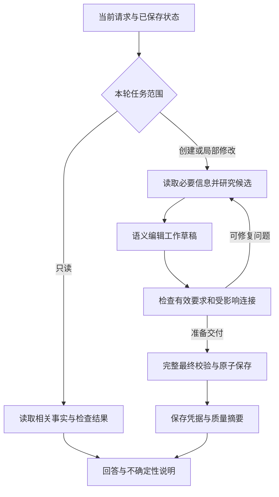

# 旅行规划 Agent 优化报告

日期：2026-10-30。范围：地点 API、工具接口、用户要求、规划与校验流程、上下文效率，以及结果展示。本文提出后续设计，不改变现有运行行为。性能数字对应已记录三轮测试的源码指纹；撰写期间预算指南发生了后续修改，这些历史结果不构成对新指南效果的验证。

## 核心判断

建议保留单个规划 agent，让它负责理解需求、选择候选、安排旅行和解释取舍。应用继续负责证据引用、计算、校验、草稿、并发保护和最终保存。在这个边界上补齐三个环节：研究结果能够进入正式行程，用户要求能够得到独立验证，局部任务只读取和处理必要内容。

现有系统已经能生成并保存完整行程，也能准确修改局部内容、恢复被拒编辑和完成只读核对。最明显的不足是，系统容易把“内容齐全且保存成功”当成工作结束。地点定位、步行偏好、具体服务时间等问题虽然被诚实地标成未知，却没有稳定地驱动后续改进。

优先完成地点数据链路和验证闭环，再优化执行成本。当前证据不足以支持更换模型、引入多个独立 agent 或重写整个 Plan 数据结构。

## 实测依据与解释边界

本次使用相同模型和代码，在真实网页新建独立项目并连续完成三轮。原始输入、逐轮响应、保存结果及诊断分别由[首次规划记录](testing/browser/runs/2026-10-30-b054-location-aware-rome.md)、[换餐厅记录](testing/browser/runs/2026-10-30-b055-nearby-restaurant.md)和[只读复核记录](testing/browser/runs/2026-10-30-b056-read-only-location-review.md)保存。[地点审计](tasks/main-location-api-audit/report.md)记录独立接口探测和字段断点，本文不复制完整对话。

| 任务 | 实际结果 | 执行量 | 设计含义 |
| --- | --- | --- | --- |
| 生成三天罗马行程 | 三天、九餐、两晚酒店及预算保存成功；六个定位结果均未匹配，20 段连接全部未验证 | 180.476 秒，23 步，3 次研究，1 次主动定位 | 创建与保存可用，但用户的步行偏好没有完成验证 |
| 替换星期五午餐 | 只改午餐及其费用说明；新餐厅成功定位，两条步行路线进入地图；其他两天和酒店不变 | 110.948 秒，21 步，3 次研究，2 次定位，1 次完整路线检查 | 局部修改准确，执行成本却接近首次生成；明确的地理要求能促使模型进一步核查 |
| 只读核对 | 准确报告两段已检查路线及剩余未知；行程、预算、文档和地图证据均未改变 | 16.237 秒，4 步，仅读取行程、预算和路线 | 读取真实状态并解释结果的路径已经有效，应保留 |

最终八个定位结果中，一条匹配、四条有歧义、三条无结果。两条路线通过检查，另外 18 段连接仍未验证。这是一个案例的观察，不是服务整体命中率或产品可靠性统计。

| 模型报告用量 | 首次规划 | 换午餐 | 只读核对 |
| --- | ---: | ---: | ---: |
| 主规划输入 tokens | 947,688 | 631,919 | 90,929 |
| 其中缓存输入 tokens | 308,423 | 327,393 | 40,431 |
| 主规划输出 tokens | 4,411 | 1,894 | 849 |
| 嵌套研究输入 tokens | 65,145 | 64,253 | 0 |
| 系统指令最大字节数 | 60,953 | 24,853 | 18,660 |
| 历史消息最大字节数 | 155,740 | 136,459 | 38,620 |

输入量是每步重复处理后的累计值，不是一次请求的上下文长度。字节数不能换算为 tokens，缓存与未缓存输入需要分别记录。以上数据未换算成账单金额。换午餐的 21 步中有五次指南读取和一次被拒后修正的费用编辑；现有事件没有保留具体指南参数及被拒参数，不能断言五次读取全部重复，也不能替该费用拒绝指定根因。

## 保留现有有效边界

继续使用语义编辑命令，由服务端构造内部时间、来源和住宿覆盖字段。继续保留稳定活动标识、批次原子性、拒绝义务跟踪、受保护预订、并发检测、可恢复工作草稿，以及 Plan、Budget、Library 的最终原子保存。

最终保存凭据仍是“已保存”的依据。保存后关闭写工具、用已验证状态生成回复的做法应保留。只读复核准确，局部编辑也没有改动其他安排，说明这些边界不需要因地图质量问题被推翻。

当前已经具备阶段化指南、摘要与按需读取、统一质量检查、路线缓存和受限研究。优化应修正这些机制的缺口，不能把它们重新包装成尚未存在的新架构。参见[Agent 指南](modules/agent.md)、[动作结果](modules/agent-actions.md)及[地点与路线](modules/geo.md)。

## 信息模型与事实归属

先明确谁保存事实，再决定 agent 读取哪些工具。下表是建议的目标边界，其中结构化要求和定位结果关联需要后续实现。

| 对象 | 具体内容与用途 | 权威存储与关系 | 初始状态与独立加载边界 |
| --- | --- | --- | --- |
| 用户消息 | 原始要求、补充、更改和明确预订事实 | 现有聊天记录；其他对象引用消息来源，不复制完整原文 | 新项目无历史；按当前输入或来源引用读取 |
| Plan | 正式活动、日期、地点选择、时间、住宿覆盖及固定安排 | 现有 Plan；持有活动与地点证据引用 | 未创建时为空；按摘要、天、活动或住宿独立读取 |
| Budget | 人数、金额范围、预算上限、计价单位、费用覆盖及价格来源 | 现有 Budget；通过活动引用关联 Plan | 未创建时为空，未知金额保持未知；按摘要、费用或活动链接读取 |
| Travel brief 与结构化要求 | 节奏、饮食、到达窗口、步行偏好、局部修改范围及例外 | 建议在现有单例 planning_context 的版本协议内增加结构化要求；可读 Markdown 是同一版本的投影 | 新项目没有推断出来的要求；启动只加载有效要求摘要，来源原文按需读取 |
| 地点候选 | 研究得到的名称、地址、适用性和网页依据，供选择或放弃 | 请求内候选及现有工作草稿；选中后进入 Plan，未选中不形成第二份正式行程 | 候选为空；仅在研究、选择和修复时读取 |
| 地图证据 | 查询、匹配结果、坐标、路线、检查时间及有效期 | 现有旅程隔离的 geo_evidence；Plan 和路线结果引用证据 | 无证据表示未知；按地点或路线读取，几何只交给地图 |
| 检查结果 | 当前计划的结构问题、用户要求满足情况、路线覆盖和费用覆盖 | 从当前 Plan、Budget、有效要求及证据版本计算；缓存是派生结果 | 尚未检查与未通过不同；默认摘要，具体问题按需展开 |

日期由 Plan 拥有，人数和预算上限由 Budget 拥有。Travel brief 引用这些字段，不再维护另一份可独立修改的数值。研究材料可以进入 Library，但不再复制日程、费用台账或整份路线报告。

结构化要求最小需要：要求类型、目标范围、强度、值与单位、来源、有效状态。例如，“尽量单段步行不超过 25 分钟”应保存为全程步行偏好，不能升级成身体活动能力限制。“星期五午餐离万神殿十分钟内”只作用于相应午餐选择及连接，不能自动扩大成三天所有地点的要求。“有素食选项”也不等于所有餐食必须全素。

建议将新增要求与对应 Plan、Budget 修改放在同一次最终保存中。旧文档先保留原文，提取结果经过来源与含义核对后再进入结构化字段；没有值就保持未知。后续修改的有效范围和是否长期保留需要明确，不能靠关键词把一次性指令变成永久偏好。

本次换餐厅后，Travel brief 仍是第一版，没有记录新的局部距离条件。这不影响当轮成功，却意味着另一个聊天不能只依靠该文档恢复完整的有效要求。结构化要求的价值在于保存这类有效条件，而不是再增加一份泛化总结。

## 地点研究到正式行程的优化

### 先修复定位查询

当前名称、地址、城市拼接成一个自由文本查询。Hotel Pantheon 的结果缺门牌和街道，不能通过精确匹配；独立对照中只查同一街道门牌和城市，便能得到通过相同规则的地址。另一个餐厅在两种查询中都失败，所以回退查询只能改善一部分情况。

建议优先保留现有查询，再在无法精确匹配时，执行一次规范化街道门牌查询。地址拆分需要保留街道、门牌、邮编、城市、省份与国家的各自含义；不要把省份等附加词当成街道词。匹配仍检查国家、城市、门牌和地址精度，不因有一个高分候选便接受坐标。

Pelias 提供结构化地理编码，但官方仍将其标为 beta。因此先实现并验证已有自由文本端点的地址回退，结构化查询单独验证 HeiGIT 的实际接口、权限和返回格式后再启用，不能由上游文档直接推断当前账号支持。[Pelias 结构化查询说明](https://github.com/pelias/documentation/blob/master/structured-geocoding.md)

每个真实 HTTP 尝试都必须消耗请求预算。当前 24 次额度按一次路线检查管理；如果在 client 内加回退却不增加计数，实际请求数会超过原先约束。应同时控制单地点尝试数和整轮请求总量，保留超时、限流和取消。

有歧义、无结果与暂时服务错误应分开处理。成功定位可以沿用较长有效期；未找到或有歧义的缓存需要较短有效期，并把匹配算法版本放入缓存键，避免修好算法后继续复用旧失败结果。网络错误不能被写成确定的“没有这个地点”。

### 让定位证据进入正式地点

当前 resolvePlace 能返回匹配结果，但 editPlan 的 venueInput 拒绝定位凭据，authorPlan 又固定生成空坐标。路线指南却要求模型保留这些字段。这个冲突已通过实际语义输入复现，继续增加提示词无法解决。

建议由服务端关联证据。模型继续提供名称、地址、城市和网页来源；定位工具额外提供可引用的短凭据。编辑器收到凭据，或在旅程缓存中找到完全对应的有效 matched 结果后，校验旅程、查询身份、有效期和唯一性，再自动写入内部坐标与 geoEvidenceId。模型不填写经纬度，也不手工组装内部 geo 来源对象。引用不匹配就拒绝关联；没有结果仍可保存明确未定位的草稿。

这是对现有编辑边界的扩展，不需要立即建立全局酒店、餐厅主数据表。网页依据负责证明场所身份和适用性，地址证据负责定位；两者不能互相替代。地图能找到某个门牌，不代表餐厅在那里营业，也不代表酒店有房。

代码中显式定位引用过期时，positionFor 会直接返回未知，没有转入按地址刷新。新关联方式应同时补上过期更新路径，生成新的不可变证据，并保持老证据的历史含义。这个路径是代码分析发现的待测问题，不是本次短时浏览器测试观察到的故障。

### 保留失败原因供选择

现有 data 中已经有 matched、ambiguous、not_found。问题不在于完全没有状态，而是通用工具成功、领域结果和下一步之间的联系不够清晰。建议工具摘要直接显示：是否精确定位、采用什么查询、缺失或冲突的地址信息、是否还有受限回退，以及可以继续做什么。

候选结果还应保留用于判断的街道和门牌字段。当前候选投影已有城市、精度图层、名称、显示地址、分数和坐标，但缺少结构化街道与门牌，难以解释“同名地点为什么未通过”。保留失败诊断有助于重新研究地址，不能变成允许模型绕过匹配规则的接口。

## 用户要求与完成判断的优化

当前 reviewPlanning 已区分 readyToPublish 和 qualityComplete，这是正确起点。但它主要检查内容覆盖、链接和验证问题；路线检查比较预留时间与可用间隔，没有接收用户的最大单段步行偏好。因此，一个连接即使时间排得下，也可能违背用户希望少走路的要求。

建议把有效要求交给同一套检查逻辑，对每条要求给出“满足、违反、无法验证”及对应证据。不要新增一套只在结尾运行的模型评分来代替它。

| 要求 | 如何判断 | 缺信息时的行为 |
| --- | --- | --- |
| 指定景点 | 检查相应供应地点是否在有效安排中 | 找不到对应记录时说明，不用虚构替代 |
| 单段步行偏好 | 比较每段地图步行估计与要求；额外缓冲另列 | 有任一相关连接未知，全程状态就是部分未验证 |
| 少走路或无车 | 检查实际交通方式及走到车站的连接 | 公交不受当前路线服务支持，需要另外研究或明确待确认 |
| 素食选项 | 检查所选餐厅是否有符合要求的菜单依据及适用餐段 | 只有泛化餐厅介绍时保留未知，不把场所标签当成菜单证明 |
| 不改酒店或其他日期 | 比较受保护范围与修改差异 | 需要扩大范围时先说明真实冲突，不能静默改动 |
| 预算上限 | 使用 Budget 已有计算结果比较上限 | 未定价项目不能按零计入，也不能据此宣称完全符合预算 |

保存条件与要求状态继续分开。来源越权、错误引用、无效结构和未解决的受保护事实冲突应阻止保存。软偏好尚未验证可以保存为草稿，但必须显示。明确不能满足的硬条件不能只藏在普通提醒里；应尝试可行修复，或清楚交付“条件未满足”的方案并请求用户选择，不能擅自放宽。

未知不是自动失败，也不是可以直接结束的理由。建议对重要且可核查的未知执行一轮有边界的修复：改善地址、改选有证据的候选、重排受影响连接或补交通研究。达到尝试上限后停止，保留原因和下一步，不反复查询相同失败输入。本次首轮可以直接以尚未核查的行程结束，说明这种修复路径还不稳定。

饮食、实时开放和营业适用性无法仅靠结构校验保证。结构化研究结果可以让证据更容易核对，但不能把“包含有效 URL”变成“所有陈述已被证明”。

## Agent 编排与工具设计的优化

### 采用任务范围驱动的执行路径

当前 planningStage 对所有非首次生成都返回 review 与 medium。换午餐因此从读指南到研究、定位、编辑、检查、保存全部经过同一阶段。这个实现确实限制了按子任务调整指令和推理投入的空间，但本次没有隔离实验，不能断言它单独造成了全部耗时。

建议在开始时形成小型任务范围：是只读、局部修改还是首次创建；目标活动和费用有哪些；哪些内容必须保留；有哪些新要求和可用来源。它是本轮工作范围，不是复制一遍整趟旅行的新计划文件。含义不明确时保留不确定范围，避免凭关键词强制判断。

只读路径应在服务端禁用 Plan、Budget、Library 的写能力，防止只靠一句提示约束。路线缓存维护属于内部读取副作用，应与修改旅行安排分开，不能因为工具叫 read 就假定完全没有网络或存储行为。

局部修改默认读取目标活动、相邻安排、相关住宿与费用；其他日期保留摘要及受保护事实。需要时再展开。程序生成受影响集合，模型负责选择修改，不需要再添加一个由模型自由填写、可能漏掉依赖的独立影响清单。

首次创建继续分批组装三天与预算。指南选择应围绕实际子任务，而不是固定把所有后续工作都归为最终复核。无需在本阶段更换模型；先验证同一模型下的工作范围与上下文调整。

### 复用已有工具并减少重复决策

保留 researchWeb、resolvePlace、editPlan、editBudget、getJourneys、inspectChanges 和 commit 等现有职责。优先改进输入输出和服务端关联，不把“换餐厅”做成一个混合研究、定价、定位和发布的巨型工具。这样的工具虽然表面少一步，却难以局部修复，也容易绕过既有保存保护。

researchWeb 已经是一次受限的嵌套模型研究。建议在现有报告中增加紧凑的候选事实结构：场所身份、街道地址、餐段、饮食依据、价格与单位、适用时间、缺失信息和来源。每项重要事实保留对应来源，缺失明确为空。文本报告用于解释，正式数值和来源仍由现有 authoring 与 EvidenceIndex 处理。

普通研究可通过 researchWeb 获取可复用结果，直接 web_search 用于针对性补证。两条路径继续共用来源登记，避免同一事实查两遍。先记录现有调用的具体问题和返回覆盖，再决定是否限制某条入口，不能仅凭同时存在两个工具就判定冗余。

对同一草稿的写入继续串行。只读地址查询、独立候选核查或服务端预取可以在统一限流下并发，但不是引入多个自主 agent。它们必须共享取消信号、请求额度和来源隔离，不能各自维护一份旅行事实。

指南、工具描述和实际 schema 应作为同一个接口维护。关键示例需要直接通过公开输入解析和执行测试，例如从定位返回值到酒店或餐厅编辑，不能只测试各自字段存在。对未提供的工具、已删除的字段和不一致的计价示例建立明确检查，减少模型在相互矛盾的说明中自行猜测。

## 上下文和重复检查的优化

主规划累计输入远高于输出，说明应首先测量每轮携带的信息量。当前每步重新拼接系统指令、阶段指南、动态环境和增长中的工具历史。已有摘要和作用域读取，但历史工具结果不会因此自动消失。

建议分成三层：稳定核心规则、当前子任务的指南、紧凑的状态与差异。已载入的指南明确标记；同一请求内不要重复请求同一版本，缺少的指南仍可按需读。本次日志不足以逐项认定指南重复，后续应记录 guideId 与版本来核对。

状态层只放必要的当前要求、活动与费用摘要、保存状态、未解决问题和相关来源索引。大段研究原文、完整历史文件与已处理的工具结果按需取回。若压缩工具历史，必须保留工具调用和结果配对、有效来源、被拒编辑义务及恢复所需状态；不能简单截断最后若干条消息。先用现有 SDK 的协议与恢复测试验证，再进行真实对比。

已有最终回复路径会切到很小的上下文，本次首次规划结束前也确实发生了这种收缩。应保留，并为它补充应用生成的变更摘要和当前质量状态。保存摘要不能只依赖模型提交的描述，否则容易把“模型说查过”当成已取得证据。

路线检查也应减少无意义重复。每次编辑批次可复用相同 fingerprint、有效期和证据版本下的检查结果；地点或交通方式变化只重算受影响的连接，时间变化复用路线并重算是否排得下。标题、原因和提醒变化不应再次请求相同路线数据。

最终保存仍验证完整有效行程，不能把“只检查受影响部分”作为漏掉其他冲突的理由。当前缓存已经避免重复向地图供应商取路线，但多次整图检查仍可能重复读取证据。请求内去重和报告复用应先解决这一层，具体收益再用 RPC 数量与耗时验证。

## 结果展示与解释的优化

保存状态、定位状态、路线状态和要求状态应分别展示。不要只给一个“完成”或一个总分。

本次局部路线成功后，页面显示约 0.5 公里映射步行和 25 分钟建议预留，却没有列出两条已验证路线各自的地图分钟数。聊天又让用户去 Plan 查看这些数值。建议在相邻安排之间按需显示：路线距离、地图估计、额外预留、实际间隔、检查时间和未确认项。日地图显示覆盖范围，未知路段不按零公里解释。

只显示对当前地点有用的状态。一个餐厅门牌已定位，并不能说明其开门时间、素食食材或餐桌已确认；一个公交窗口排了 50 分钟，也不能显示成已查到具体公交。全程报告两段已核查、18 段待确认时，日程提醒也应由相同结果生成，避免仍笼统写成所有步行时间未知。

最终回复使用服务端当前事实：本轮改了什么、哪些内容保存、哪些要求满足、哪些仍无法验证、预算范围和必要的下一步。保留来源和不确定性，但不要重复整份日程，也不要把内部凭据与工具名带给普通旅客。

## 分阶段实施建议

| 阶段 | 改动与主要位置 | 完成标准 |
| --- | --- | --- |
| 第一阶段 修复地点链路 | services/places/geo 与 feasibility：地址回退、地址分量匹配、失败原因、过期刷新；services/assistant/agent/authoring：证据关联及读回；同步修正路线指南 | 已知可定位地址能通过现有语义工具保存证据，刷新后地图与读回一致；错误城市、分店、其他旅程及过期引用不能静默通过 |
| 第二阶段 检查用户要求 | 现有 planning_context 版本与 workspace 保存协议；lib/planning-review；agent 的完成反馈 | 当前步行、饮食和局部保护要求有来源与范围，分别显示满足、违反或未知；只读请求不能写旅行内容 |
| 第三阶段 缩小任务上下文 | agent/context、guides、model 和 workspace/views；受影响连接与请求内缓存 | 同一结果与保护条件下，减少无关读取和重复上下文；最终完整校验、草稿恢复与可信保存不退化 |
| 第四阶段 展示与持续测量 | lib/journeys/view、lib/plan/day-view、诊断与现有浏览器记录 | 逐段分钟数、缓冲、覆盖和未知清晰可见；单次调用成功不会被统计成地点匹配成功 |

第一阶段无需等待结构化要求迁移。第二阶段需要单独设计文档版本兼容和保存事务。每阶段都更新现有维护指南与公开工具接口测试，避免行为、schema、指南和显示各自演进。新职责确需新模块时遵守仓库的 lib、services 与 index.ts 约定，不为目录整齐拆分大量文件。

## 验收与衡量方式

先补确定性回归，再进行预算明确的真实网页对比。当前请求只形成报告，不启动新一轮付费测试。

| 验收场景 | 必须观察到的结果 |
| --- | --- |
| 名称查询失败但门牌可用 | 受限回退取得地址，保持原场所身份与网页依据；记录各真实请求 |
| 完整地址与多门牌 | 邮编、省份不被当成街道；多门牌或两个精确候选不被强行选成唯一结果 |
| 定位到编辑再到刷新 | 使用模型实际公开 schema 完成，不通过内部 propose 注入完整 Plan 绕过边界 |
| 错误、过期与恢复 | 错误引用被拒，过期证据可受限更新；中断恢复保留已接受活动和来源，不重复写入 |
| 用户步行与饮食要求 | 已知违规能被指出，未知不会变成满足；局部距离条件不会污染全程范围 |
| 换一顿午餐 | 只改允许的活动、相邻安排和必要费用，其他日期及固定事实保持不变；最终全图校验仍执行 |
| 只读核对 | 仅读取旅行事实与检查结果，准确解释分钟数与缓冲，Plan、Budget、Library 不变 |
| 不支持的交通和服务失效 | 不用驾车时间替代公交，不用直线距离冒充步行路线，不制造零分钟成功结果 |

稳定记录定位匹配与失败原因、候选数量、地图真实请求、缓存命中、路线覆盖、用户要求状态、被拒编辑及修复次数。关联到本轮操作和内部引用，常规日志不记录密钥、完整网页、用户原文或精确地址；必要的受控测试证据继续放在忽略目录。

效率同时记录总耗时、每类工具耗时、模型累计输入与输出、缓存输入、嵌套研究用量、最大上下文字节数和数据库读取数。不要把不同来源的用量混在一起，也不要只用工具调用数衡量有效性。

建议将首次规划累计主输入减少约 30%、同范围午餐编辑减少约 50%作为待验证的性能目标，同时要求质量和保存正确性不退化。这些不是收益承诺。对比要固定模型、任务范围和工具协议，并记录外部研究结果变化。先用固定证据夹具比较上下文，再用真实网页确认实际行为；少量成功不能换算成可靠性百分比。

本次相关 46 项测试通过，仍漏掉了公开编辑边界的断点。因此下一轮质量门槛应同时包含字段契约、持久保存、实际约束与网页呈现。测试数量增加本身不是完成标准。

## 代码定位与后续决策

| 关注点 | 当前入口 |
| --- | --- |
| 地图查询与匹配 | [client.ts](../services/places/geo/client.ts)、[matching.ts](../services/places/geo/matching.ts)、[geo/index.ts](../services/places/geo/index.ts) |
| 路线与证据检查 | [feasibility/index.ts](../services/places/feasibility/index.ts)、[routes.ts](../services/places/feasibility/routes.ts) |
| AI 编辑与读回 | [authoring/inputs.ts](../services/assistant/agent/authoring/inputs.ts)、[authoring/plan.ts](../services/assistant/agent/authoring/plan.ts)、[authoring/index.ts](../services/assistant/agent/authoring/index.ts) |
| 阶段和上下文 | [completion.ts](../services/assistant/agent/context/completion.ts)、[instructions.ts](../services/assistant/agent/context/instructions.ts)、[guides/index.ts](../services/assistant/agent/guides/index.ts)、[model.ts](../services/assistant/agent/model.ts) |
| 保存与环境 | [session.ts](../services/workspace/session.ts)、[artifacts.ts](../services/workspace/artifacts.ts)、[evidence.ts](../services/workspace/evidence.ts) |
| 质量与呈现 | [planning-review](../lib/planning-review/index.ts)、[journey view](../lib/journeys/view.tsx)、[day locations](../lib/plan/day-view/locations.ts) |

目前最值得实施的是第一阶段的地点链路修复，并以同一组真实输入验证。结构化要求和任务范围是下一层改进，应该在事实归属清楚后增加。更换模型、增加自主 agent、全局地点主数据和新的规划框架都暂不列入近期范围；若上述改进后仍出现明确能力瓶颈，再用对照实验决定。
